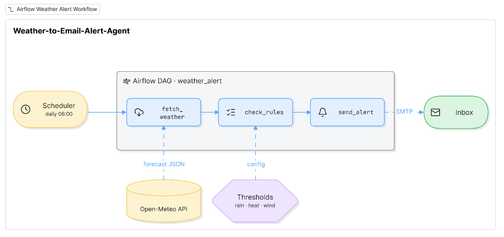

# Weather-to-Email-Alert-Agent

Airflow-orchestrated weather alert pipeline. Fetches the daily forecast from [Open-Meteo](https://open-meteo.com), checks configurable rain, heat, and wind thresholds, and emails an alert via SMTP when a threshold is crossed.




## Features

- Free weather data, no API key needed
- Configurable location and thresholds through environment variables
- One Airflow task per stage, so each has its own retries and logs
- Modular code: swap the weather API or the notification channel without touching the rest
- Pure-logic rules module, easy to test without network or inbox

## Project structure

```
weather-alert/
├── dags/
│   └── weather_alert_dag.py   # Airflow DAG (scheduler)
├── src/
│   └── weather_alert/
│       ├── __init__.py
│       ├── config.py          # settings from environment variables
│       ├── weather.py         # Open-Meteo API client
│       ├── rules.py           # threshold checks -> alert messages
│       ├── notifier.py        # email sending (SMTP)
│       └── main.py            # standalone runner for local testing
├── tests/
│   ├── test_rules.py
│   └── test_weather.py
├── .env.example
├── .gitignore
├── requirements.txt
├── requirements-dev.txt
└── README.md
```

| Module | Responsibility |
|---|---|
| `config.py` | Loads settings and required secrets |
| `weather.py` | Fetches and normalizes the forecast |
| `rules.py` | Turns forecast data into alert messages (no I/O) |
| `notifier.py` | Sends the email |
| `main.py` | Runs the whole pipeline without Airflow |
| `weather_alert_dag.py` | Wraps each stage as an Airflow task |

## Requirements

- Python 3.9+
- Docker and Docker Compose (for the Airflow setup)
- A Gmail account with 2-Step Verification and an [App Password](https://myaccount.google.com/apppasswords), or any other SMTP provider

## Configuration

Copy the template and fill in your values:

```bash
cp .env.example .env
```

| Variable | Required | Default | Description |
|---|---|---|---|
| `EMAIL_FROM` | Yes | – | Sender address |
| `EMAIL_APP_PASSWORD` | Yes | – | SMTP / Gmail App Password |
| `EMAIL_TO` | Yes | – | Recipient address |
| `SMTP_HOST` | No | `smtp.gmail.com` | SMTP server |
| `SMTP_PORT` | No | `465` | SMTP SSL port |
| `CITY` | No | `Nairobi` | Name used in the email |
| `LAT` / `LON` | No | `-1.29` / `36.82` | Location coordinates |
| `RAIN_THRESHOLD_MM` | No | `5` | Alert if daily rain is at or above this |
| `HEAT_THRESHOLD_C` | No | `33` | Alert if max temperature is at or above this |
| `WIND_THRESHOLD_KMH` | No | `40` | Alert if max wind speed is at or above this |

> Never commit `.env`. Only `.env.example` belongs in the repo.

## Run locally (without Airflow)

Do this first to confirm the code works.

```bash
python -m venv .venv
source .venv/bin/activate            # Windows: .venv\Scripts\activate
pip install -r requirements-dev.txt

set -a; source .env; set +a          # load the .env file
export PYTHONPATH=src

pytest                               # run tests
python -m weather_alert.main         # run the pipeline
```

Expected output is either `Alert sent.` or `No alerts today.` followed by the forecast.

To force an email while testing:

```bash
RAIN_THRESHOLD_MM=0 python -m weather_alert.main
```

## Run with Airflow (Docker)

**1. Get the official compose file**

```bash
curl -LfO "https://airflow.apache.org/docs/apache-airflow/2.10.5/docker-compose.yaml"
mkdir -p logs plugins config
echo "AIRFLOW_UID=$(id -u)" >> .env
```

**2. Add a `Dockerfile`**

```dockerfile
FROM apache/airflow:2.10.5
COPY requirements.txt .
RUN pip install --no-cache-dir -r requirements.txt
```

**3. Edit `docker-compose.yaml`** under `x-airflow-common`:

```yaml
x-airflow-common:
  &airflow-common
  build: .                      # replaces the image: line
  env_file:
    - .env
  environment:
    &airflow-common-env
    PYTHONPATH: /opt/airflow/src
    AIRFLOW__CORE__LOAD_EXAMPLES: 'false'
  volumes:
    - ./dags:/opt/airflow/dags
    - ./src:/opt/airflow/src
```

**4. Build and start**

```bash
docker compose build
docker compose up airflow-init
docker compose up -d
```

**5. Trigger the DAG**

1. Open http://localhost:8080 (default login: `airflow` / `airflow`).
2. Unpause the `weather_alert` DAG.
3. Click **Trigger DAG** and check the logs of `fetch_weather`, `check_rules`, and `send_alert`.

By default the DAG runs daily at `0 6 * * *` (06:00 UTC, which is 09:00 in Nairobi).

Run it once from the terminal, without the scheduler:

```bash
docker compose exec airflow-scheduler airflow dags test weather_alert 2026-11-01
```

> After changing `.env`, restart the containers: `docker compose down && docker compose up -d`.

## Customizing

- **Change the schedule:** edit `schedule=` in `dags/weather_alert_dag.py`.
- **Use local time:** set a timezone-aware `start_date`, e.g. `pendulum.datetime(2025, 1, 1, tz="Africa/Nairobi")`.
- **Add a new alert type:** add a threshold in `config.py`, a field in `weather.py`, and a check in `rules.py`.
- **Switch to Slack, Telegram, or SMS:** replace `notifier.py` only.
- **Use another weather API:** replace `weather.py` only, keeping the same returned dict keys.

## Troubleshooting

| Symptom | Likely cause | Fix |
|---|---|---|
| `ModuleNotFoundError: weather_alert` | `src/` not on the path | Check the `./src` volume mount and `PYTHONPATH` |
| `ModuleNotFoundError: requests` | Image built without dependencies | Run `docker compose build` again |
| `Missing required environment variable` | `.env` not loaded | Confirm `env_file:` is set and restart containers |
| DAG missing in the UI | Import error | Run `airflow dags list-import-errors` |
| Gmail `Authentication failed` | Normal password used | Use a 16-character App Password |

## Testing

```bash
export PYTHONPATH=src
pytest
```

`rules.py` has no network or email code, so its tests run instantly with no setup.

## License

This project is open-source and licensed under the terms of the [MIT LICENSING](LICENSE).
